# Manual de usuario · Mesa de Servicios Universitarios

Versión para la entrega final (fases III y IV). Responsable: Emanuel (paquete A).

La Mesa de Servicios Universitarios permite registrar, atender y seguir solicitudes de mantenimiento,
infraestructura, soporte informático y servicios administrativos de la universidad. Cada solicitud tiene un
código único, una prioridad, plazos de atención y un historial completo de lo que pasó con ella.

## Contenido

1. [Ingreso al sistema](#1-ingreso-al-sistema)
2. [Solicitante](#2-solicitante)
3. [Técnico](#3-técnico)
4. [Supervisor](#4-supervisor)
5. [Administrador](#5-administrador)
6. [Estados, prioridades y plazos](#6-estados-prioridades-y-plazos)
7. [Preguntas frecuentes y mensajes de error](#7-preguntas-frecuentes-y-mensajes-de-error)

---

## 1. Ingreso al sistema

### 1.1 Crear una cuenta (solo solicitantes)

1. En la pantalla de inicio de sesión, elige **Crear una cuenta**.
2. Completa nombre completo, correo institucional, vínculo con la universidad (estudiante, docente o
   administrativo) y contraseña. La contraseña debe confirmarse.
3. Pulsa **Crear cuenta**. El sistema te devuelve al inicio de sesión con el correo ya escrito.

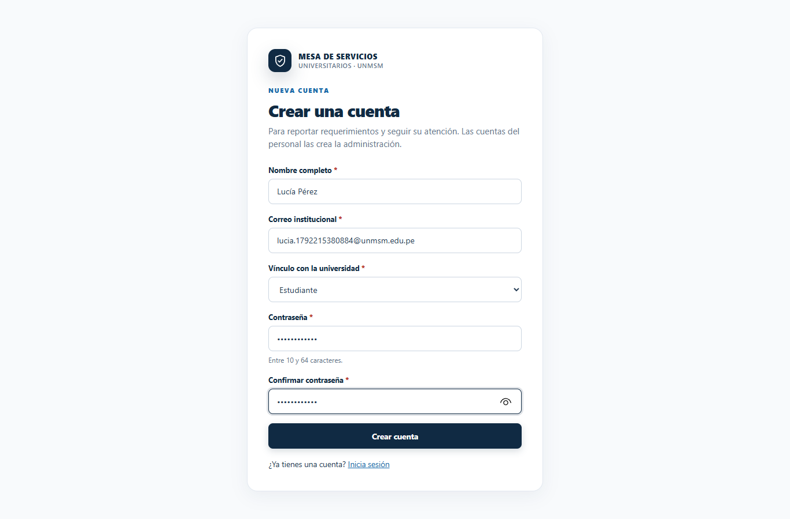

Las cuentas de técnicos, supervisores y administradores no se registran desde aquí: las crea el administrador.

### 1.2 Iniciar y cerrar sesión

1. Escribe tu correo institucional y tu contraseña, y pulsa **Iniciar sesión**.
2. El sistema te lleva a la pantalla principal de tu rol. El menú lateral (o la barra inferior en el celular)
   solo muestra las opciones que te corresponden.
3. Para salir, abre tu nombre en la parte inferior del menú y elige **Cerrar sesión**.

La sesión dura dos horas. Por seguridad también se cierra si cambias tu contraseña o si el administrador
cambia tu rol, tu área o desactiva tu cuenta.

**Protección ante intentos repetidos:** con la configuración habitual, cinco intentos fallidos desde la misma
cuenta y dirección de red bloquean nuevos inicios por 15 minutos. El sistema muestra un aviso de demasiados
intentos; espera el plazo indicado. No es un cambio de contraseña ni elimina tus datos. Las redes con muchos
intentos fallidos también tienen un límite general.

### 1.3 Mi perfil

En **Mi perfil** puedes cambiar tu nombre y tu contraseña. Para cambiar la contraseña escribe la actual, la
nueva y su confirmación. El correo, el rol y el área los administra la universidad.

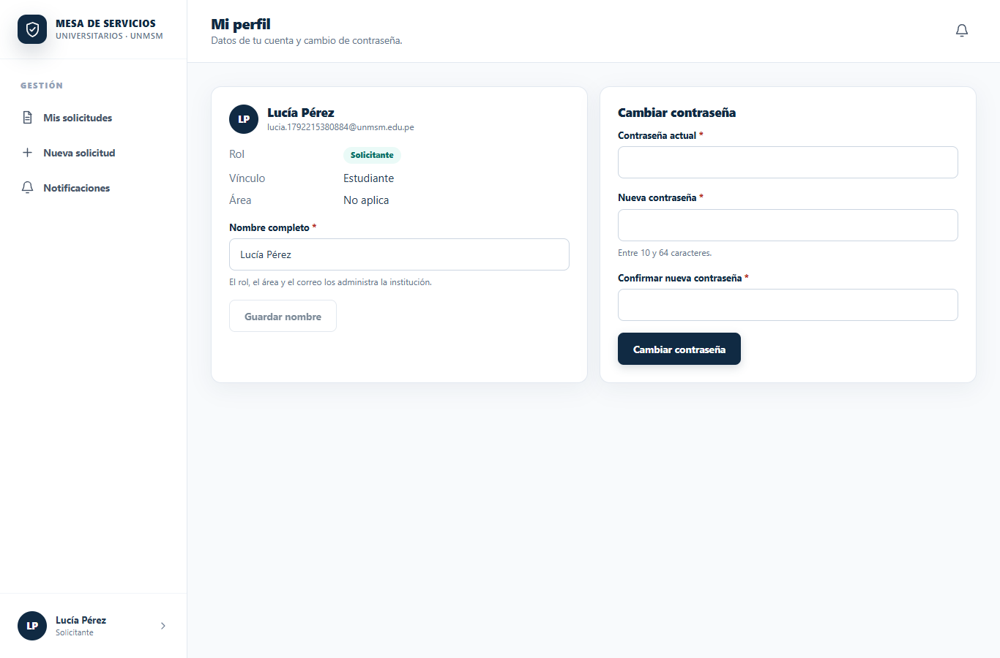

### 1.4 Notificaciones

La campana de la parte superior muestra cuántos avisos tienes sin leer. En **Notificaciones** puedes:

- ver **Todos** o solo los **No leídos**;
- marcar un aviso como leído o **marcarlos todos** a la vez;
- **eliminar** un aviso propio (el historial de la solicitud no se modifica).

Recibes avisos cuando cambia el estado de tus casos, cuando te asignan uno, cuando un plazo llega al 80 % o
vence, y cuando se reabre o cancela una solicitud.

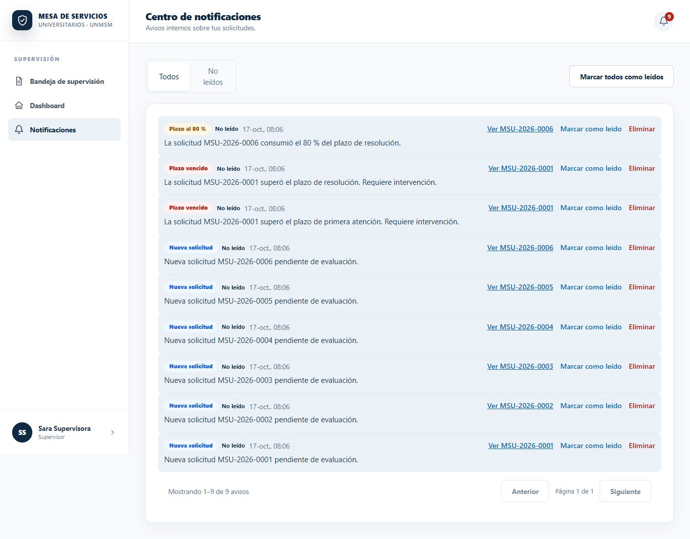

---

## 2. Solicitante

Estudiantes, docentes y personal administrativo registran y siguen sus propias solicitudes. Nadie más que tú
(y el personal que la atiende) puede ver tus solicitudes.

### 2.1 Registrar una solicitud

1. Elige **Nueva solicitud**.
2. Selecciona la **categoría** (el área responsable aparece sola) y la **ubicación** (edificio y ambiente).
   Puedes agregar una **referencia** para encontrar el lugar.
3. Escribe la **descripción** del problema (mínimo 20 caracteres).
4. Indica el **impacto** (a cuántas personas o actividades afecta) y la **urgencia** (qué tan pronto debe
   resolverse). La **prioridad estimada** se calcula y se muestra en el momento.
5. Pulsa **Registrar solicitud**. El sistema muestra el código (por ejemplo, `MSU-2026-0012`), la prioridad y
   las fechas límite.

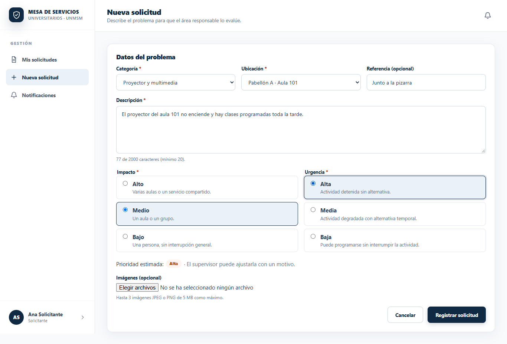

Si falta un dato obligatorio, el mensaje aparece junto al campo y la solicitud no se registra.

### 2.2 Consultar mis solicitudes

**Mis solicitudes** lista tus casos con su estado, prioridad y semáforo de plazo (a tiempo, por vencer o
vencido). Puedes buscar por código o descripción y filtrar por estado. Al pulsar un código se abre el
seguimiento.

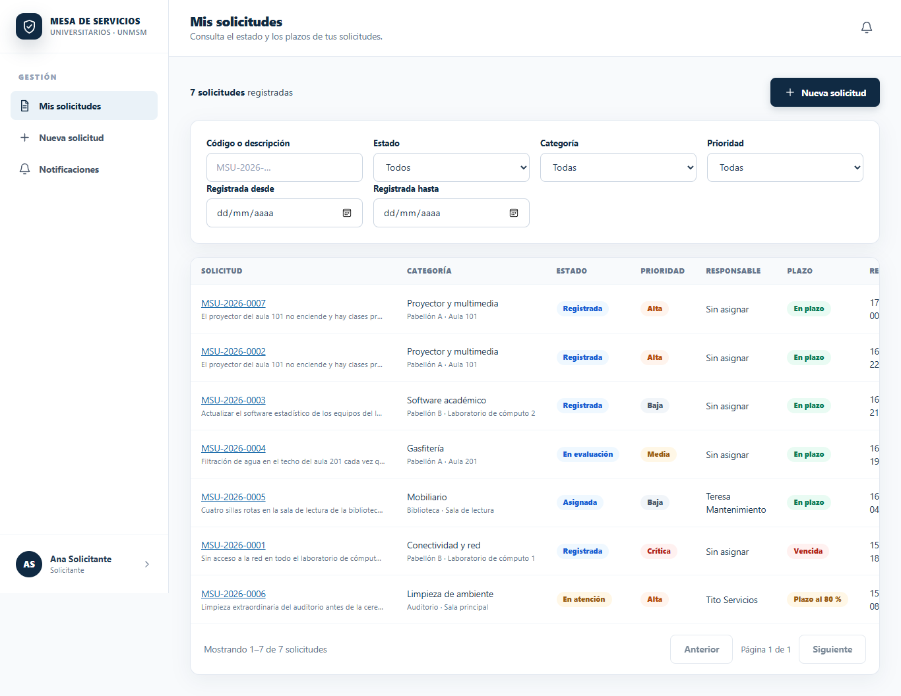

### 2.3 Seguimiento, comentarios y evidencias

El seguimiento de una solicitud muestra los datos del caso, las fechas y plazos, el responsable y el
**historial** con cada cambio (quién, cuándo y qué).

- **Comentarios:** de 1 a 1000 caracteres, mientras la solicitud no esté cerrada ni cancelada. No se editan ni
  se borran.
- **Evidencias:** hasta 3 imágenes JPEG o PNG de 5 MB como máximo. Solo las pueden abrir las personas
  autorizadas para ver la solicitud.

### 2.4 Confirmar la solución o reabrir

Cuando el técnico registra la solución, la solicitud queda **Resuelta** y tienes **72 horas** para responder:

- **Confirmar solución:** la solicitud pasa a **Cerrada**.
- **El problema persiste:** explica qué sigue fallando (10 a 1000 caracteres) y pulsa **Reabrir**. El técnico
  retoma la atención y se conservan los plazos originales.

Si no respondes en 72 horas, el sistema cierra la solicitud automáticamente.

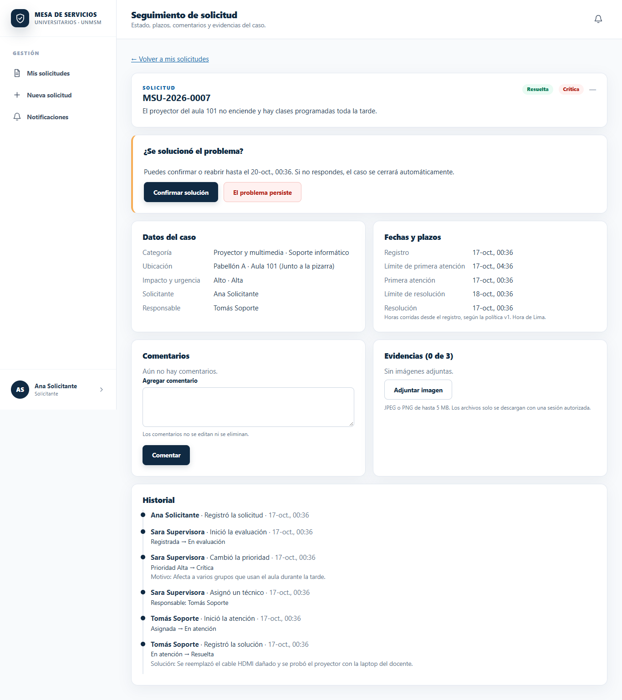

### 2.5 Calificar la atención (encuesta)

Cuando la solicitud está **Cerrada** aparece **¿Cómo calificas la atención?**.

1. Elige una calificación del **1** (muy insatisfecho) al **5** (muy satisfecho).
2. Si quieres, agrega un comentario de hasta 500 caracteres.
3. Pulsa **Enviar calificación**.

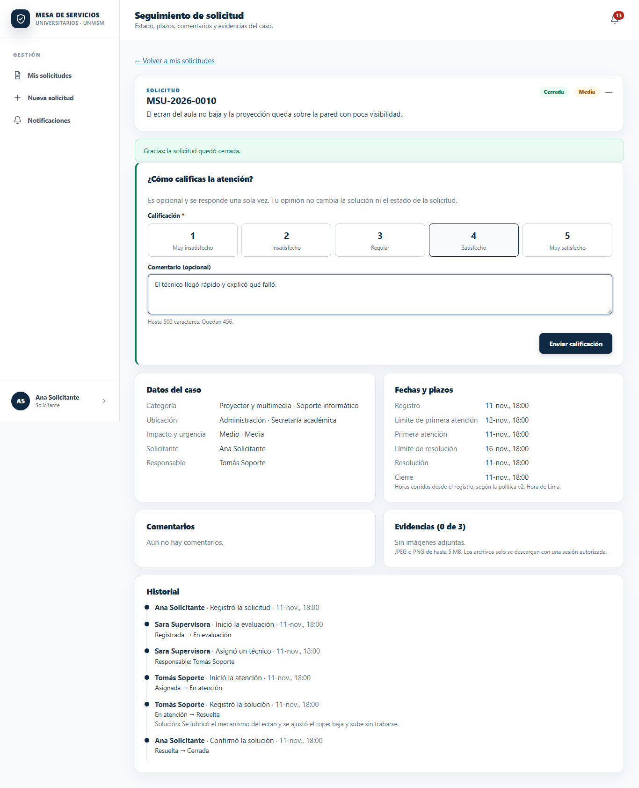

La encuesta es opcional y se responde **una sola vez**. Después verás tu calificación registrada. Calificar no
cambia la solución ni el estado de la solicitud.

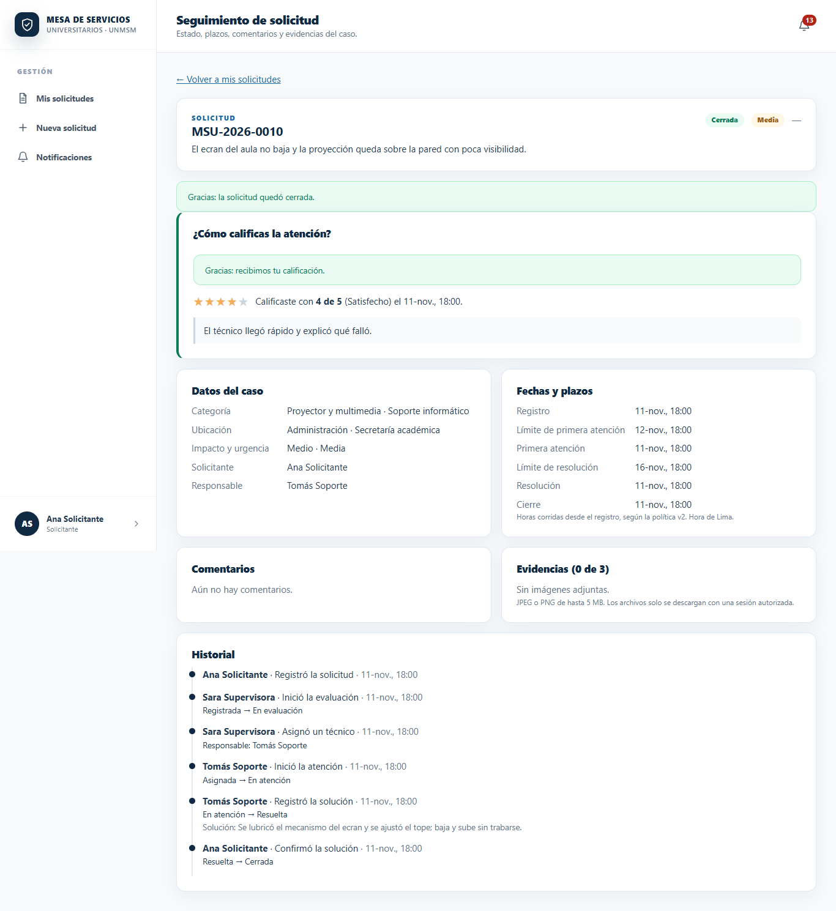

---

## 3. Técnico

### 3.1 Mis asignaciones

**Atención técnica** muestra solo las solicitudes asignadas a ti, ordenadas por vencimiento. Puedes filtrar
por estado y abrir cada caso.

### 3.2 Iniciar la atención

En una solicitud **Asignada**, pulsa **Iniciar atención**. La solicitud pasa a **En atención** y queda
registrada la hora de la primera atención (solo la primera vez, aunque luego se reabra).

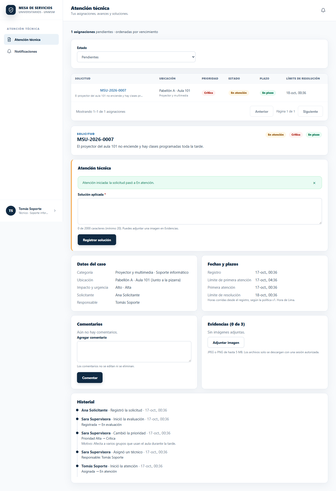

### 3.3 Registrar la solución

1. En una solicitud **En atención**, describe en **Solución aplicada** lo que hiciste (20 a 2000 caracteres).
2. Pulsa **Registrar solución**. La solicitud pasa a **Resuelta** y el solicitante recibe un aviso para
   confirmar o reabrir.

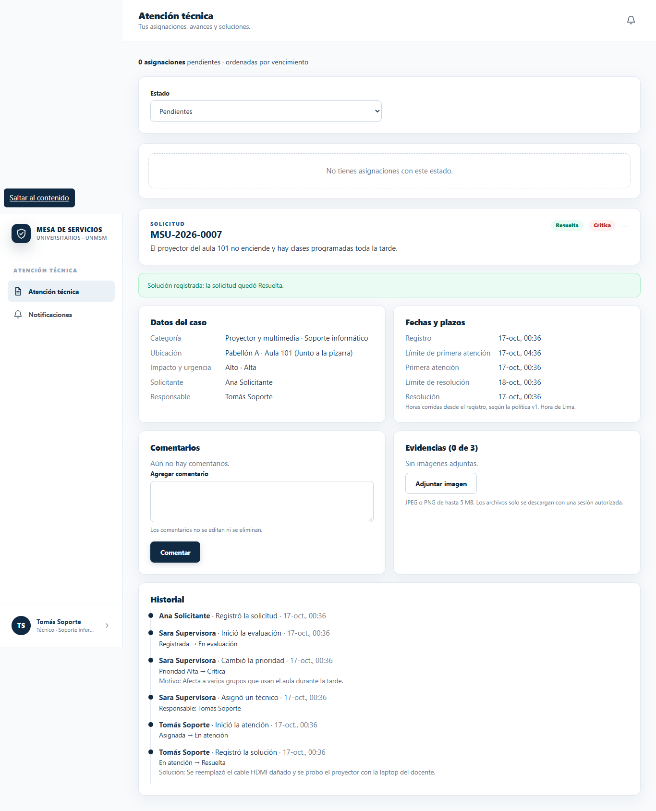

Si otra persona cambió la solicitud mientras la tenías abierta, verás un aviso de conflicto y el caso se
recargará para que revises el cambio antes de continuar.

---

## 4. Supervisor

### 4.1 Bandeja de supervisión

La **Bandeja de supervisión** reúne las solicitudes de la facultad. Puedes filtrar por estado, área,
categoría, prioridad, responsable y fechas, y ordenar por prioridad o vencimiento.

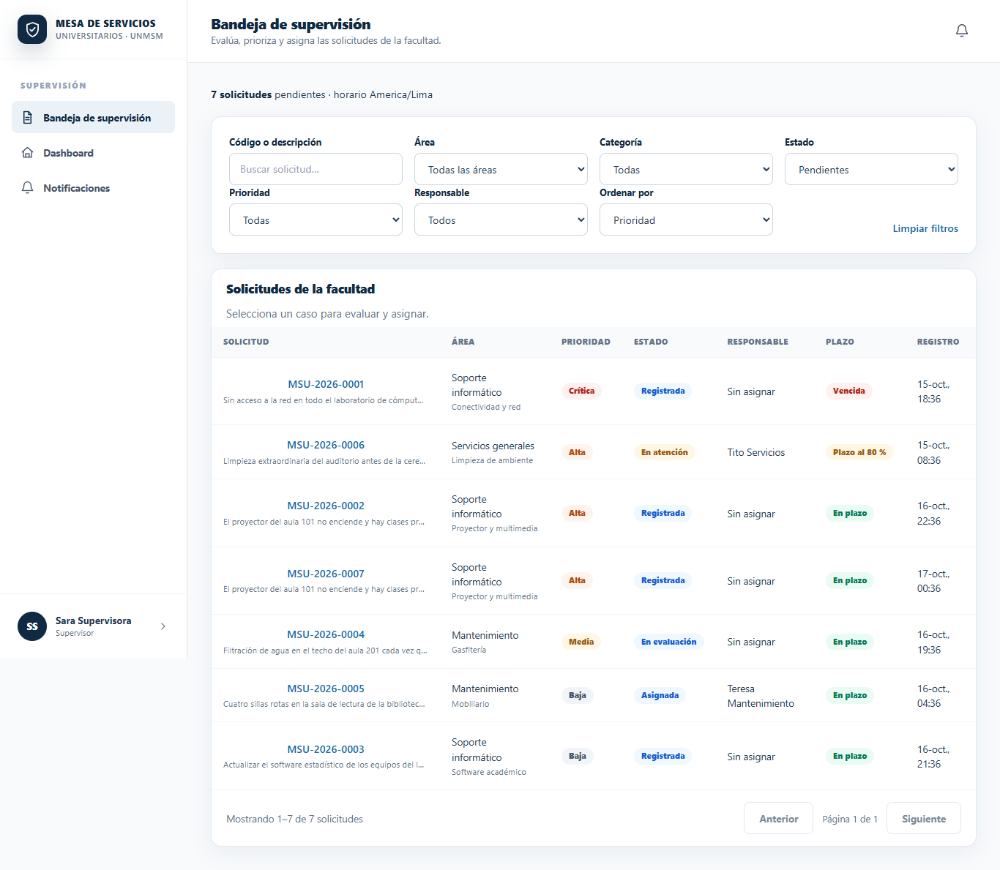

### 4.2 Evaluar y priorizar

1. Abre una solicitud **Registrada** y pulsa **Iniciar evaluación**. Pasa a **En evaluación**.
2. Si el impacto o la urgencia no son correctos, cámbialos e indica el motivo. La prioridad y los plazos se
   recalculan desde la hora de registro, con la política que tenía el caso.

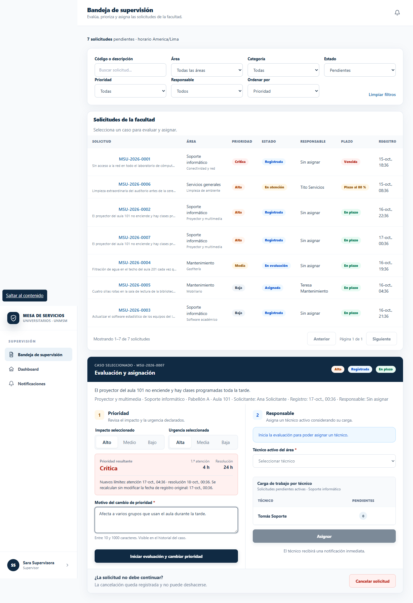

### 4.3 Asignar y reasignar

Elige un **técnico activo del área** y pulsa **Asignar**. Para cambiar de técnico, elige otro e indica el
**motivo de la reasignación**. El historial guarda el técnico anterior, el nuevo, el motivo y quién lo hizo.

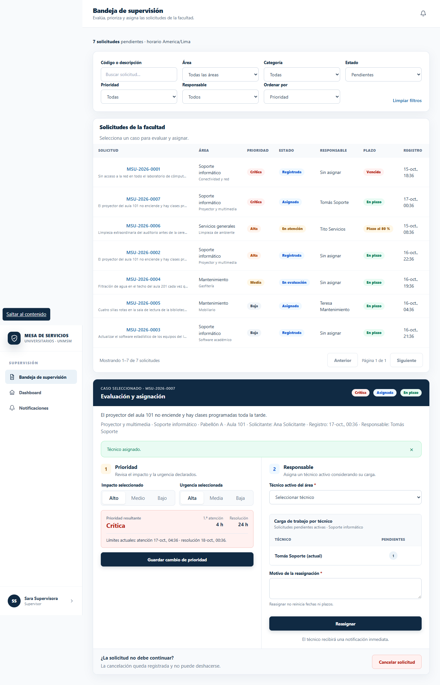

### 4.4 Cancelar una solicitud

**Cancelar solicitud** exige un motivo. Si es un duplicado, indica el código de la solicitud original. No se
pueden cancelar solicitudes Resueltas ni Cerradas.

### 4.5 Dashboard e informe CSV

El **Dashboard** muestra los indicadores del periodo y del área elegidos:

- solicitudes registradas, pendientes, solucionadas, canceladas y vencidas activas;
- porcentaje solucionado;
- primera atención a tiempo y resoluciones dentro del plazo;
- tiempo medio de resolución;
- satisfacción promedio y número de encuestas;
- distribución por categoría, prioridad y responsable.

Si no hay datos en el periodo, el indicador muestra **Sin datos**. **Exportar CSV** descarga el listado con
los mismos filtros, listo para abrir en Excel.

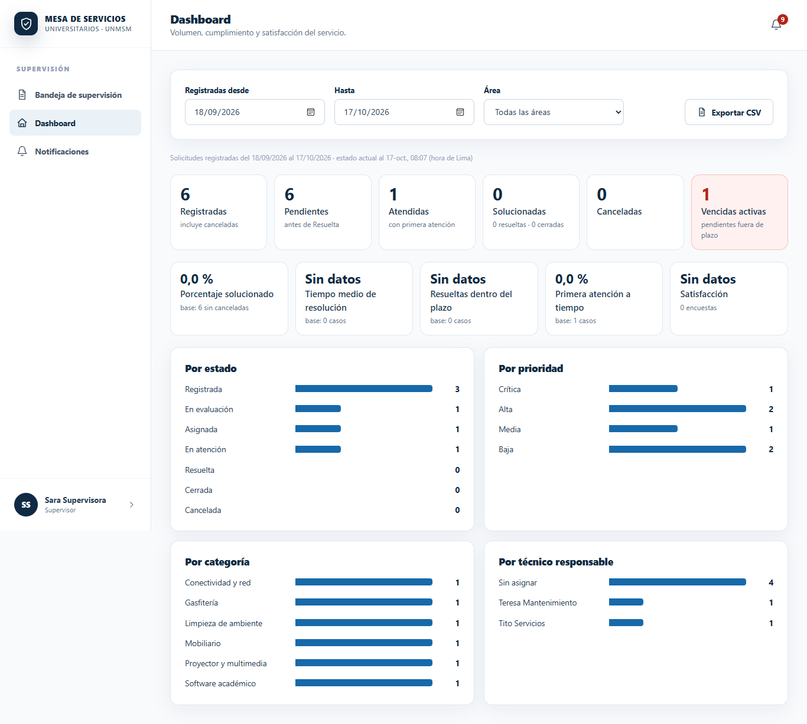

---

## 5. Administrador

El administrador gestiona cuentas internas, catálogos, plazos y la auditoría. Por privacidad, no ve el
contenido de las solicitudes ni sus imágenes.

### 5.1 Usuarios internos

En **Usuarios internos** puedes:

- **Crear usuario:** técnico, supervisor o administrador. Un técnico debe pertenecer a un área activa.
- **Editar:** nombre, rol, área o estado de una cuenta.
- **Desactivar o reactivar** una cuenta.

No se puede desactivar ni cambiar de rol o área a un técnico que tenga casos pendientes: primero el supervisor
debe reasignarlos. Tampoco puedes desactivar tu propia cuenta ni cambiar tu propio rol.

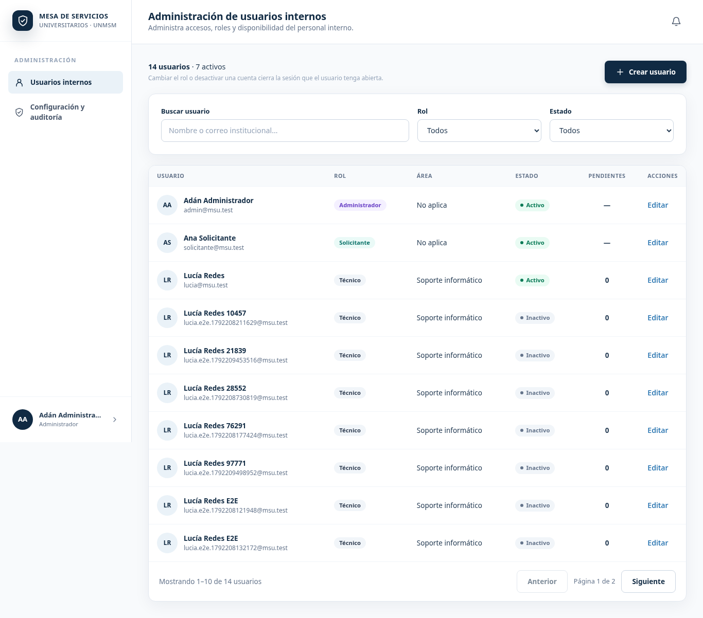

### 5.2 Catálogos

En **Configuración y auditoría → Catálogos** se mantienen las áreas, categorías y ubicaciones. Los elementos
no se borran: se **desactivan**, dejan de ofrecerse en nuevas solicitudes y siguen visibles en los casos
anteriores. Los estados y las prioridades son fijos: solo puedes cambiar el nombre que ven los usuarios.

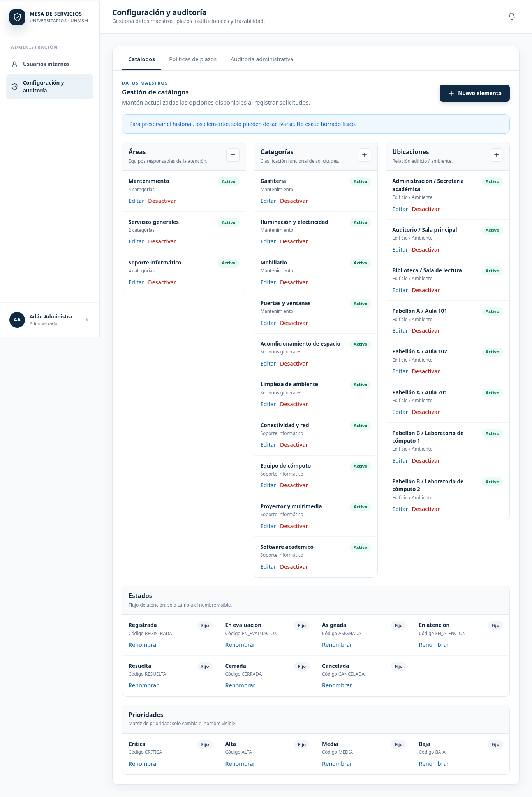

### 5.3 Políticas de plazos

En **Configuración y auditoría → Políticas de plazos** ves la **versión vigente**: horas de primera atención y
de resolución por prioridad. Debajo está el **historial de versiones**, con cuántas solicitudes usa cada una.

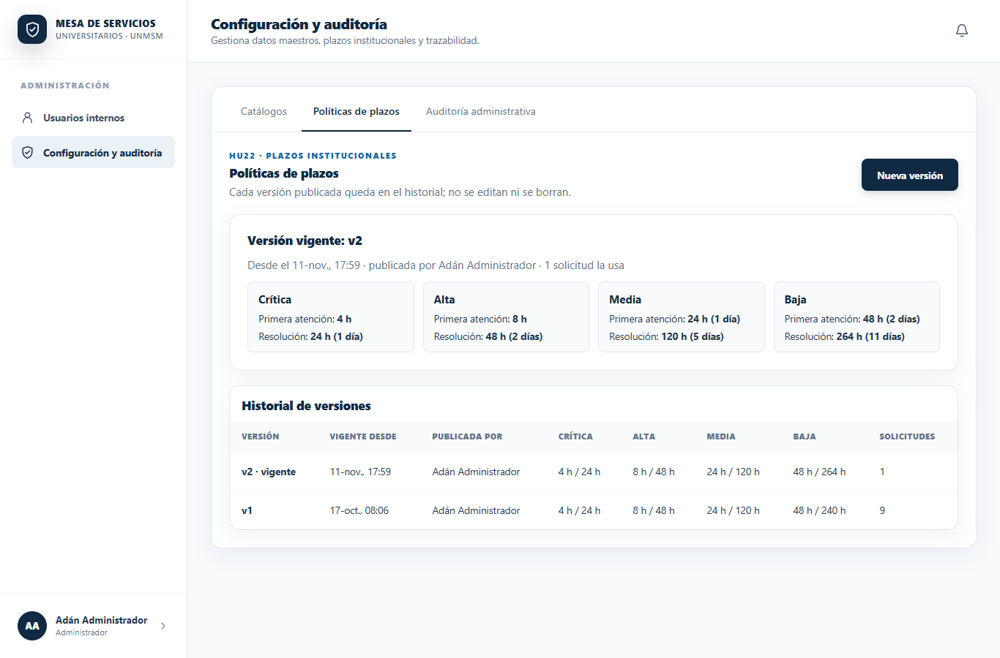

Para cambiar los plazos:

1. Pulsa **Nueva versión**. El formulario se llena con la versión vigente.
2. Cambia las horas. Reglas:
   - todos los valores son horas enteras mayores que cero;
   - la primera atención no puede superar la resolución;
   - una prioridad más urgente no puede tener plazos más largos que la siguiente
     (Crítica ≤ Alta ≤ Media ≤ Baja).
3. Pulsa **Revisar y publicar** y confirma con **Publicar**.

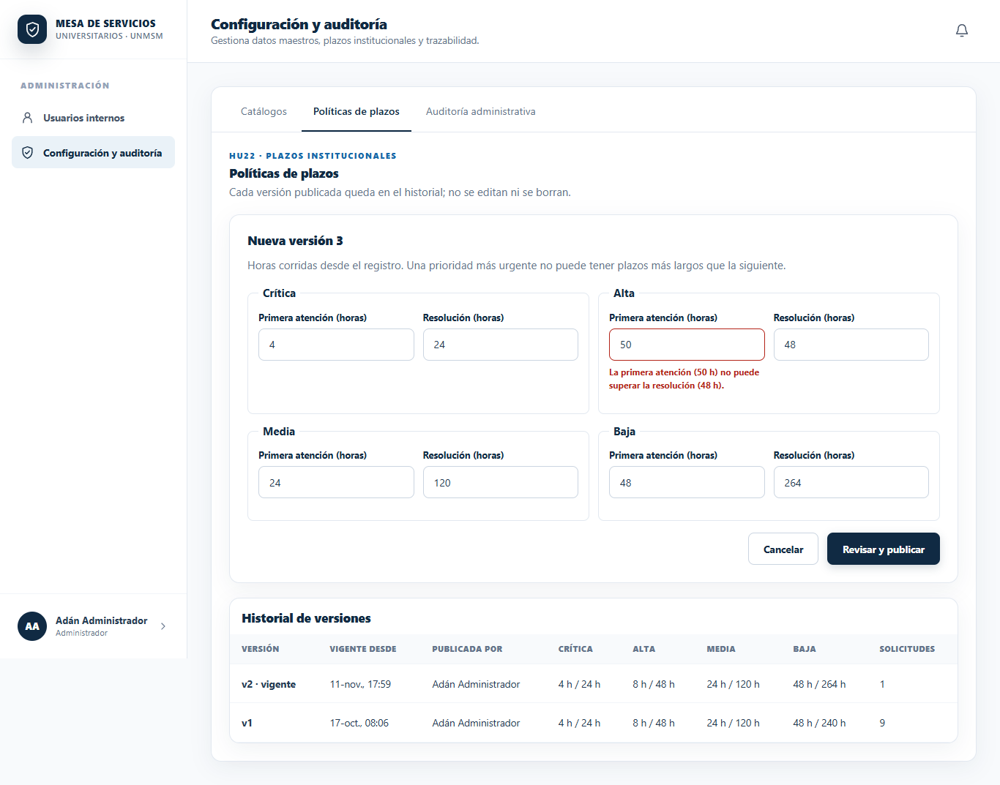

La versión nueva rige **desde ese momento para las solicitudes nuevas**. Las solicitudes existentes conservan
los plazos con los que se registraron. Las versiones anteriores no se editan ni se borran. Si otra persona
publicó mientras editabas, el sistema te pedirá recargar antes de publicar.

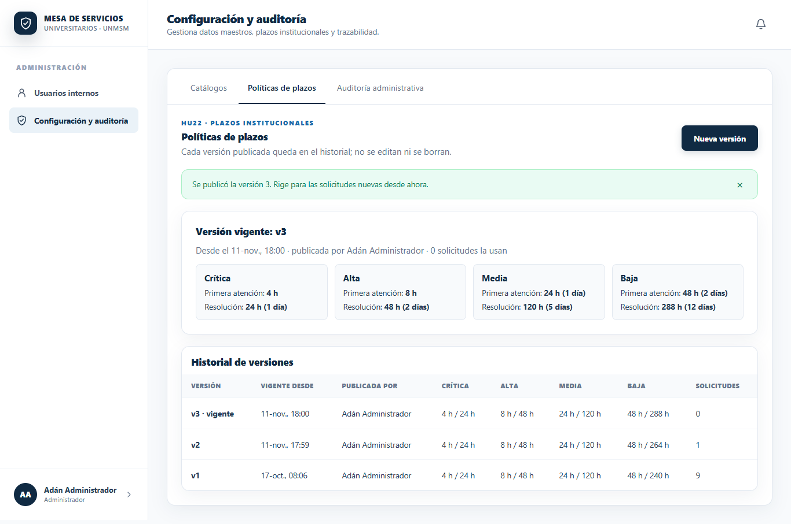

### 5.4 Auditoría administrativa

En **Configuración y auditoría → Auditoría administrativa** se consulta quién hizo cada acción y cuándo:

- inicios de sesión, cierres e intentos rechazados;
- registros de cuenta y cambios de perfil o de contraseña (sin guardar la contraseña);
- altas y cambios de usuarios internos, con el valor anterior y el nuevo;
- cambios en catálogos y publicación de políticas;
- exportaciones CSV del supervisor;
- limpieza automática de sesiones vencidas.

Puedes filtrar por acción, entidad, actor (nombre o correo) y fechas. La auditoría **no se puede editar ni
borrar** y nunca muestra contraseñas, tokens ni archivos.

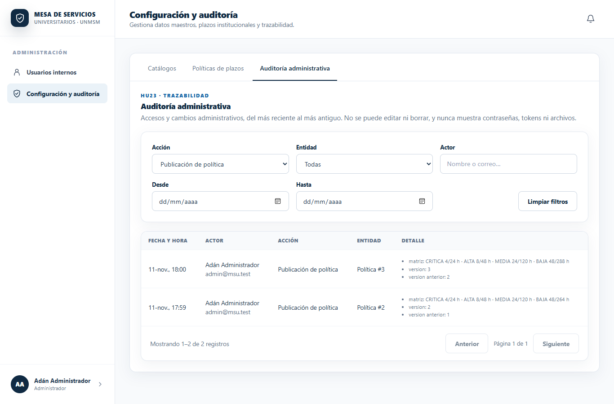

---

## 6. Estados, prioridades y plazos

| Estado | Significado | Quién lo cambia |
|---|---|---|
| Registrada | El solicitante creó la solicitud | Solicitante |
| En evaluación | El supervisor revisa prioridad y área | Supervisor |
| Asignada | Tiene un técnico responsable | Supervisor |
| En atención | El técnico está trabajando | Técnico (también al reabrir) |
| Resuelta | Hay una solución; corre la ventana de 72 h | Técnico |
| Cerrada | Confirmada por el solicitante o cerrada automáticamente | Solicitante o sistema |
| Cancelada | Excepción con motivo (por ejemplo, duplicado) | Supervisor |

**Prioridad.** Resulta de cruzar el impacto con la urgencia: Crítica, Alta, Media o Baja.

**Plazos.** Se cuentan en horas corridas desde el registro, según la política vigente. Valores de la
versión 1:

| Prioridad | Primera atención | Resolución |
|---|---|---|
| Crítica | 4 h | 24 h |
| Alta | 8 h | 48 h |
| Media | 24 h | 120 h (5 días) |
| Baja | 48 h | 240 h (10 días) |

**Semáforo.** «Por vencer» aparece al consumir el 80 % del plazo, y entonces el responsable y el supervisor
reciben un aviso. «Vencido» aparece al superar el límite.

---

## 7. Preguntas frecuentes y mensajes de error

| Mensaje o situación | Qué significa | Qué hacer |
|---|---|---|
| «Correo o contraseña incorrectos.» | Datos de acceso inválidos o cuenta desactivada | Revisa los datos; si persiste, contacta al administrador |
| «Su sesión no es válida o expiró.» | Pasaron dos horas o tu acceso cambió | Vuelve a iniciar sesión |
| «No tiene permiso para realizar esta operación.» | La acción o la solicitud no corresponde a tu rol | Usa una cuenta con el rol adecuado |
| «Otro usuario modificó estos datos…» | Alguien cambió la solicitud mientras la veías | Revisa el caso recargado y repite la acción si sigue siendo necesaria |
| «Terminó el periodo de 72 horas…» | La ventana de conformidad venció | La solicitud se cerrará automáticamente |
| «Ya calificaste la solicitud…» | La encuesta ya fue respondida | No hace falta hacer nada |
| «Los plazos son iguales a la versión vigente…» | La nueva política no cambia nada | Ajusta al menos un valor o cancela |
| La imagen no se sube | Supera 5 MB, no es JPEG/PNG o ya hay 3 en la solicitud | Reduce el archivo o conviértelo a JPEG/PNG; con 3 imágenes no se aceptan más |

Ante cualquier error inesperado, el mensaje incluye un **identificador de correlación**. Compártelo con el
equipo técnico para ubicar el problema en los registros del sistema.
